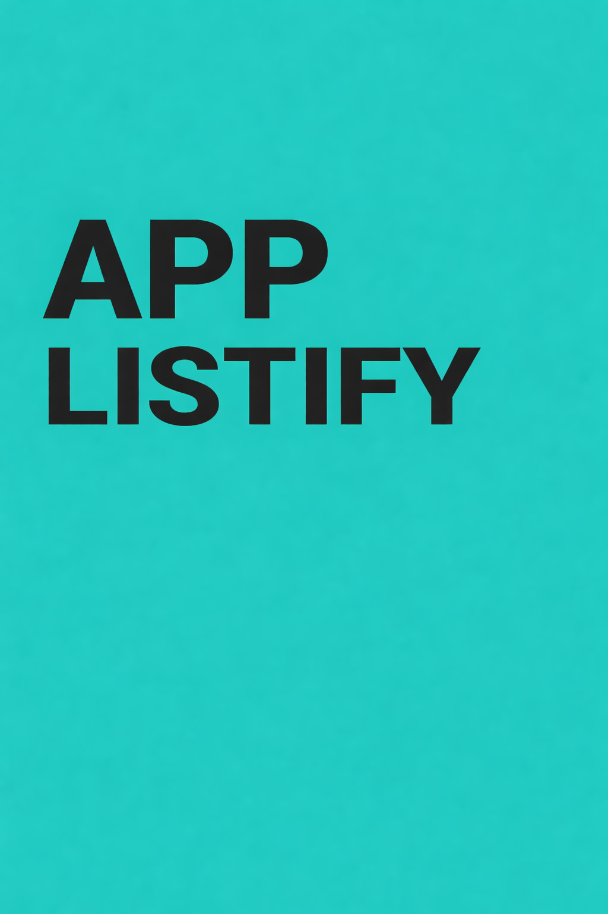

<p align="center"></p>

<h1 align="center">📚 ListiFy App</h1>

<p align="center"><em>Angular application for organizing personal collections.</em></p>

<p align="center">🇧🇷 <a href="README.md">Português</a> | 🇺🇸 English</p>

<p align="center"> </p>

<p align="center"><a href="#sobre">About</a> • <a href="#tecnologias">Technologies</a> • <a href="#como-rodar">Running locally</a> • <a href="#licenca">License</a> • <a href="#autor">Author</a></p>

---

<a id="sobre"></a>
## 📖 About

ListiFy frontend developed with Angular 16, TypeScript, Bootstrap and Tailwind CSS. It uses the API maintained in ListiFy.Api.

## ✨ Features

- Collection management interface
- ASP.NET Core API integration

## 🛠️ Technologies

   

## 📦 Prerequisites

Node.js and npm compatible with the Angular version used by this project.

<a id="como-rodar"></a>
## 🚀 Running locally

```bash
git clone https://github.com/Felipe-Amorim-Dev/ListiFy.App.git
cd ListiFy.App
npm ci
npm start
```

http://localhost:4200

## 🔗 Related repositories

- [ListiFy.Api](https://github.com/Felipe-Amorim-Dev/ListiFy.Api) — Back-end ASP.NET Core

## 🏗️ Architecture and responsibilities

- AppModule registers components, routes, forms and HttpClient.
- AuthenticationGuard protects collection and account routes.
- src/environments/environment.ts configures apiBaseUrl, listifyUsuario and listifyItem.

### Execution flow

1. Angular forms → HTTP requests → ListiFy.Api → SQL Server
2. Dedicated components implement registration, catalogue, item updates and account screens.

### Local execution

```bash
npm ci
npm start
```

Project endpoint: http://localhost:4200

<a id="licenca"></a>
## 📄 License

Distributed under the [MIT license](LICENSE).

<a id="autor"></a>
## 👤 Author

**Felipe Figueiredo Amorim** — Full Stack Developer.

[](https://www.linkedin.com/in/felipe-amorim-dev/) [](mailto:felipe.f.amorim@outlook.com)

<p align="center"><strong>Obrigado por visitar! / Thanks for visiting!</strong></p>
